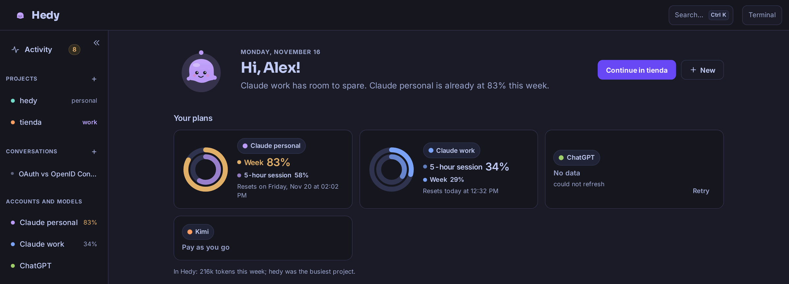
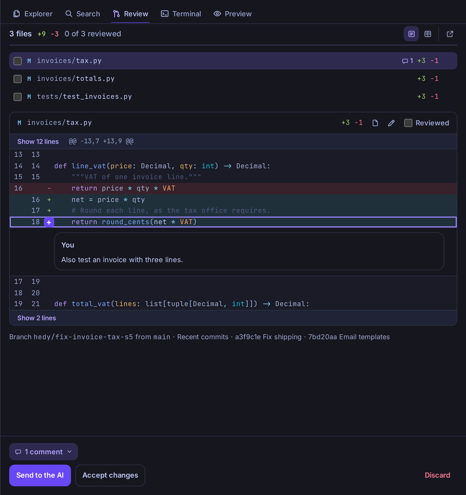
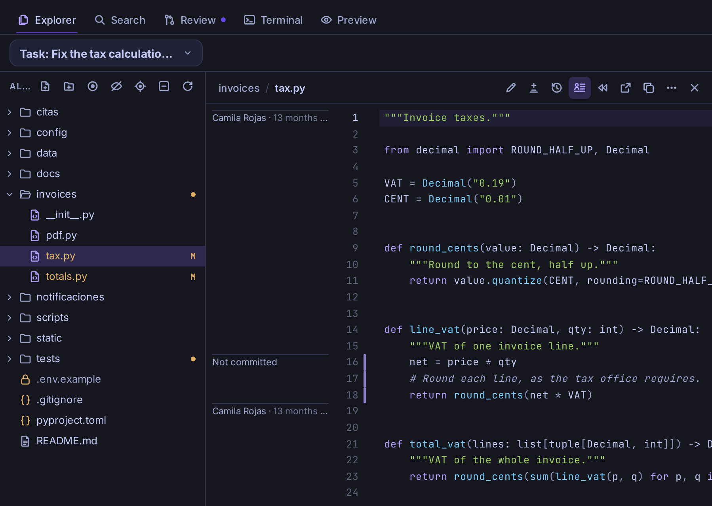
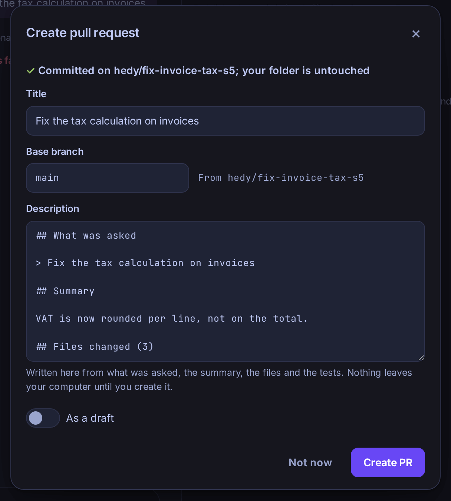

<div align="center">


# Hedy

**Your coding AIs and your accounts, in one place.**

Claude Code, Codex, Gemini CLI, Kimi Code and Antigravity, with as many accounts as you have,
without mixing them up.

[](LICENSE)

[](https://github.com/enriqueleonq1/hedy/releases)

<a href="docs/media/hedy-intro.mp4">
  
</a>

<sub>Click the preview for the full video.</sub>

</div>

---

I had a work subscription, a personal one, and three terminals open at any given time. More than
once I asked the wrong account to do the wrong job, or hit a limit halfway through something and
had to work out where I'd left it. Hedy is what I built to stop doing that.

It doesn't replace the CLIs. It runs the official ones, unmodified, each with the account you
picked for that project, and gives you one window to start tasks, see what they're doing, review
what they changed and ship it.

## What it does

- **Several providers, several accounts.** Claude Code, Codex, Gemini CLI, Kimi Code, Antigravity,
  plus Kimi and Gemini by API key. Each project knows which account it uses. Work stuff stays on
  the work account.
- **Plan usage at a glance.** The same numbers `/usage` gives you, for every account, refreshed
  every few minutes. When you hit a limit, Hedy tells you and lets you wait, switch provider or use
  an API key. It never moves you to another subscription on its own.
- **Tasks in parallel, on their own branch.** Each task works in a separate git worktree. Nothing
  touches your folder until you accept it.
- **Review it like a pull request.** Diff with context, comments on any line, and one click to
  send them all back to the AI as a single follow-up.
- **Find your way around.** File explorer, `Ctrl+P`, text search, history, blame, and "before the
  AI" to see a file as it was when the task started. Small edits right there; anything bigger opens
  in VS Code at the same line.
- **Ship.** Commit with a suggested message, push, open the PR. Your git, your credentials.
- **Memory that you approve.** Agents can propose notes and procedures for a project. Nothing is
  used until you say yes.
- **Quick questions.** Ask something outside any project, and if it turns into work, carry the
  conversation into a project with its context.
- **Make it look like your editor.** One Dark Pro, Dracula, Catppuccin, Nord, GitHub,
  Solarized and Hedy's own. Click one and the whole app previews it before you commit. You can
  also import a VS Code theme file, or describe what you want and let one of your accounts draft
  it. Hedy fixes any color that wouldn't be readable.

<table>
  <tr>
    <td></td>
    <td></td>
  </tr>
  <tr>
    <td></td>
    <td></td>
  </tr>
</table>

## A few rules it sticks to

These are enforced in code, not just written down:

1. **Hedy never reads, copies or stores your session tokens.** Each subscription account lives in
   the CLI's own config folder (`CLAUDE_CONFIG_DIR`, `CODEX_HOME`, …) and you log in through the
   CLI's official flow. Hedy only picks the folder when it launches the CLI.
2. **Official binaries, unmodified.**
3. **No silent account switching** when a limit hits.
4. **API keys go to your system keyring**, never to a file.
5. **Everything is local.** No server, no telemetry, no account with us.

The details, including what was verified about each CLI and why, are in
[`docs/decisions.md`](docs/decisions.md).

## Install

Hedy is Linux-only for now. It's built with Tauri, so macOS and Windows are on the table, but I
haven't tested them.

You'll need the CLIs you want to use already installed (`claude`, `codex`, `gemini`…), plus `git`.
`gh` is optional and only used to open pull requests.

**Download**

Each [release](https://github.com/enriqueleonq1/hedy/releases) has a `.deb`, an AppImage, an Arch
package and the `hedy` command on its own. The `.deb` and the AppImage include the app only; for
the command, take `hedy-cli-*.tar.gz` and put `hedy` somewhere on your `PATH`.

**Arch / CachyOS / Manjaro, from source**

```sh
git clone https://github.com/enriqueleonq1/hedy
cd hedy/packaging/arch
makepkg -si
```

That installs the desktop app (`hedy-app`, with a menu entry) and the `hedy` command.

**From source, anywhere else**

Requires Rust (the version is pinned in `rust-toolchain.toml`), Node 20+ and the
[Tauri prerequisites](https://v2.tauri.app/start/prerequisites/) for your distro.

```sh
cargo install --path crates/hedy-cli   # the hedy command
cd app && npm ci && npm run tauri build # the desktop app
```

## Quick start

The app walks you through adding your accounts the first time you open it. From the terminal it
looks like this:

```sh
# The account you're already logged into at ~/.claude, as is
hedy account add "Claude work" --claude --default-folder

# A second one in its own folder (opens the official login)
hedy account add "Claude personal" --claude

cd ~/code/shop
hedy use claude-work    # this project uses the work account
hedy run                # opens claude with that account
hedy status             # accounts, logins and the current project
```

`hedy doctor` checks your CLIs, accounts and versions if something looks off. `hedy --help` lists
the rest.

## Development

```sh
cargo test                                   # core, CLI and memory server
cargo clippy --all-targets -- -D warnings
cd app && npm install
npm run dev          # the UI in a browser, with sample data
npm run tauri dev    # the real app
npm test
```

The Rust core is hexagonal: `domain/` is pure, `application/` holds the use cases behind ports,
`adapters/` talk to git, the CLIs, SQLite and the keyring. The CLI and the Tauri app are just two
ways in. [`CLAUDE.md`](CLAUDE.md) has the conventions.

Issues and pull requests are welcome. If you're planning something big, open an issue first so we
can talk about it.

## Why "Hedy"

After [Hedy Lamarr](https://en.wikipedia.org/wiki/Hedy_Lamarr), who co-invented frequency hopping:
jumping between channels without losing the signal. Seemed fitting.

## License

[MIT](LICENSE)
